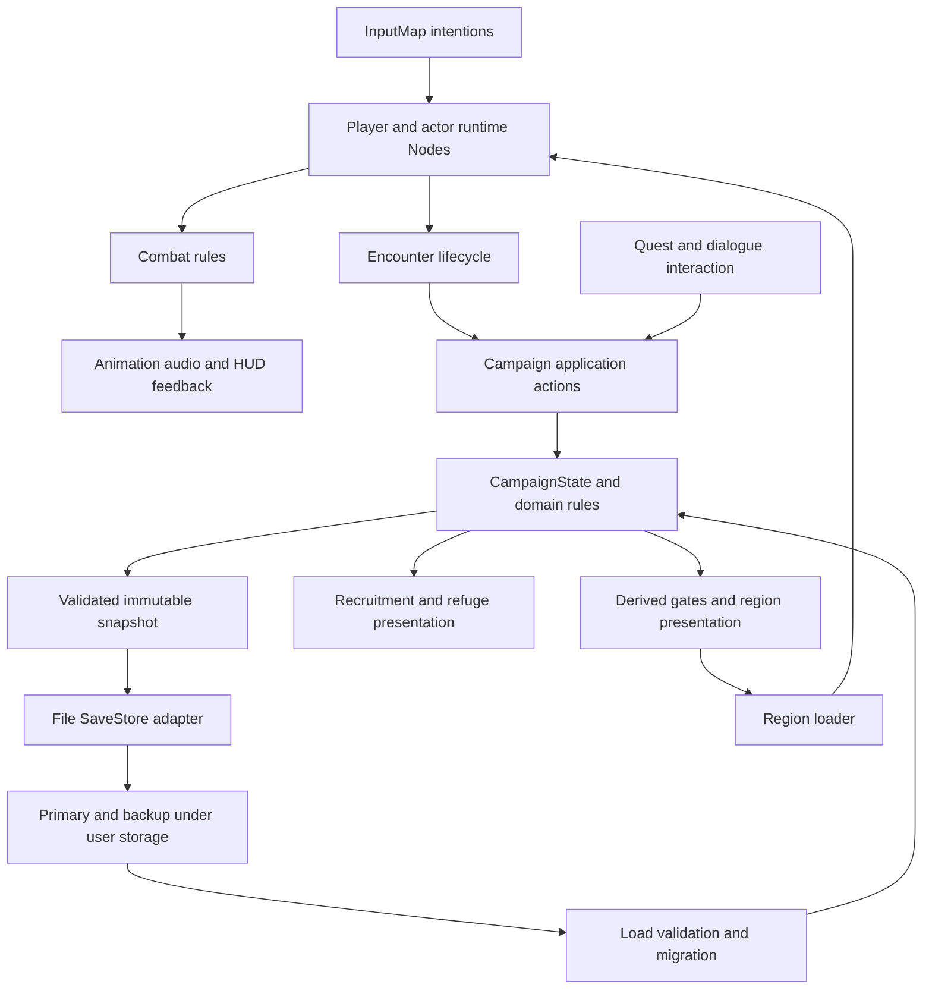

# MASTER IMPLEMENTATION PROMPT — THE KNIGHT OF LAST LIGHT

You are my lead game developer and technical partner. Build the complete small game described below incrementally, beginning with an executable graybox prototype. This prompt contains the full initial specification and the instructions that would otherwise live in separate project files. If you receive only this document, reconstruct the embedded files at their labeled paths first, then begin M0. Do not recursively copy the master into itself. If the full pack already exists, read and update its source documents rather than maintaining a second conflicting specification.

The owner explicitly approved a 3D dark fantasy adventure with a knight, an evil wizard's curse, progressively unlocked connected regions, bosses, exploration, growing strength and NPC friends/allies. Other specifics are proposed defaults. Keep the first prototype small and playable while preserving a route to the final campaign and curse-breaking ending.

Use DDD for consistent game concepts and invariants, Clean Architecture for rule/runtime separation, Clean Code for maintainability and justified design patterns. Respect Godot-native real-time development. Do not build enterprise infrastructure around every game script. Validate all linked scenes/content and preserve durable progression. Never call untested or placeholder content complete.

FIRST ACTION: inspect the current separate game repository and tooling, read the files below, report the actual engine/tooling, and implement M0 followed by M1. Do not delete other projects. Do not answer with only a plan. If engine execution is blocked, complete independent work, document the exact blocker and give reproducible setup/check commands. Do not claim interactive results you did not observe.

The following embedded documents are the implementation contract.


---

## Embedded file: AGENTS.md

# Instructions for Codex

## Mission and authority

Build this game in the current game repository through working increments. Explicit owner instructions outrank this pack. Within the pack, approved product pillars outrank proposals; numbered specifications define behavior; examples illustrate those specifications. Raise actual conflicts instead of guessing silently. MASTER_PROMPT.md is a generated snapshot, not a second editable source of truth.

Begin by reading README.md, CONTEXT.md, all numbered docs and milestone definitions. Inspect existing files, Git status and available Godot tooling. Preserve unrelated user changes. Do not delete, reset, force-push, publish, buy assets, or replace another repository without specific authorization. The CarPartAI repository is outside this game's scope.

Use English for code, identifiers and documentation. Explain progress to the owner in Bulgarian unless they request otherwise. Work locally and autonomously on reversible implementation tasks. Do not push or merge merely because a milestone passes.

## Engineering approach

Use pragmatic DDD for vocabulary and progression invariants; Clean Architecture for separating rules from runtime scenes; Clean Code for readable implementation. This is a real-time game, not a business backend. Do not add repositories, interfaces, factories or event buses to every script.

Favor deep modules: small interfaces hiding meaningful behavior. Keep movement/camera/physics in Godot-native runtime scripts. Keep damage decisions, gate evaluation, rewards, quest conditions and save validation independently testable. Use typed RefCounted objects for rules, immutable-by-convention Resource definitions for authoring, and Nodes for runtime behavior. Resource definitions must not hold per-actor mutable health or quest state.

State pattern: player actions and enemy/boss behavior. Observer: local signals with explicit ownership. Strategy: genuinely different attacks or targeting rules. Command: validated companion orders if needed. Adapter: persistence and input mapping. Composition: shared health, interaction and damage behavior. Record consequential architecture decisions in docs/adr/. Avoid generic frameworks, microservices, networking, ECS rewrites, procedural world generation and live-service infrastructure.

## Execution discipline

Create project.godot, input actions, a real boot scene and test entrypoint early. Build M0 then M1 before expanding. At each milestone, implement → import/parse → automated checks → interactive smoke test when supported → document evidence → continue to the next authorized step. When player feedback determines combat feel or art direction, request that feedback while continuing independent checks and cleanup; do not produce four additional regions before the first-region review.

Never report a visual or interactive test as performed without actually performing it. If the engine or UI is unavailable, implement what can be checked, explain the limitation, and provide reproducible verification steps. Headless success does not verify camera, animation readability, gamepad, audio or frame rate.

No missing referenced scenes, fake screenshots, empty tests, unexplained placeholders or inaccessible menu routes. Placeholder meshes and animations are allowed when visibly acknowledged. No multiplayer, generative AI, monetization or compulsory accounts in this scope.

Create/update docs/STATUS.md after meaningful milestones: implemented behavior, actual checks, known issues, next task, engine version, commit if present. Preserve manual asset work. Use small coherent commits when committing is authorized. Do not claim engine version, performance, export or licensing verification without evidence.

## First response and first work

Briefly state the engine/tooling found and the first milestone. If no engine is available, use an official portable distribution when environment/network permissions permit; otherwise provide precise setup instructions. Do not download large art packs as a substitute for implementing gameplay. Start with a graybox test room and deterministic rule tests.

---

## Embedded file: README.md

# The Knight of Last Light — Codex development pack

This is a planning and implementation-instruction package, not a playable game or a prebuilt Godot project. All documents are English. The working title, names, narrative details and balance numbers are editable proposals. The owner's approved pillars are binding.

## What the owner approved

A single-player 3D dark fantasy adventure. The player is a knight. An evil wizard has cursed the kingdom. Exploration, combat, bosses and character progression gradually unlock new connected regions and story chapters. Friendly NPCs are met over time; some join the refuge, some accompany the knight. The final confrontation defeats the wizard and enables the curse to be broken. The story will grow incrementally with the owner.

## How to use this pack

1. Create a NEW, empty game repository. Do not reuse or erase CarPartAI. Its earlier reset discussion does not authorize game files to replace that project.
2. Copy this pack into the repository root. Keep AGENTS.md, CONTEXT.md, docs/, examples/ and planning/ together.
3. Open that repository in Codex. Paste START_HERE.txt for file-based operation, or paste MASTER_PROMPT.md when transferring one document to another chat.
4. Codex implements milestone M0, then M1, and continues according to the milestone gates. A headless import is not evidence of a playable game.
5. Review the first playable movement/combat prototype before increasing content scope. Use the provided review questions; avoid an endless questionnaire before starting.

## Recommended baseline

Godot 4.7.2 standard Windows x86_64 release with typed GDScript, proposed from the official download page checked on 2026-11-03. Verify the actual executable version and pin it in ENGINE_VERSION.txt before implementation. If that release cannot be obtained, choose a supported stable Godot 4 release explicitly and verify all APIs against its matching docs. Do not silently mix engine versions or use preview releases.

Use the Mobile renderer initially for a modest 3D project; this renderer can target desktop. Benchmark the game before changing renderer or adding expensive effects. Godot engine minimum requirements do not guarantee this game's frame rate.

Known development laptop: i5-12450H, RTX 3050 Ti Laptop GPU with 4 GB VRAM, about 16 GB RAM. Previous inspection found about 59 GB free on C: and little available RAM; recheck before large downloads. Target Windows keyboard/mouse first. Gamepad is a later gate.

## Reading order

AGENTS.md → CONTEXT.md → docs/01-product-and-scope.md → docs/02-game-design.md → docs/03-world-and-narrative.md → docs/04-architecture.md → docs/05-implementation-contracts.md → docs/06-save-and-progression.md → docs/07-ui-controls-accessibility.md → docs/08-art-audio-assets.md → docs/09-performance-and-tooling.md → docs/10-roadmap.md → docs/11-testing-and-acceptance.md → docs/12-risks-and-owner-review.md.

MASTER_PROMPT.md embeds all authoritative documents and example data. It is generated from these files; edit the source files first and regenerate the master if the design changes. README.md and docs/04-architecture.md explain ownership.

## Deliverables expected from implementation

A runnable Godot project; honest prototype art; meaningful tests; Windows development build; setup and controls instructions; asset licensing register; save fixtures; test evidence; and a documented list of limitations. Final game completion requires all campaign gates, not merely the first boss.

---

## Embedded file: CONTEXT.md

# The Knight of Last Light — Domain glossary

A knight explores a cursed kingdom, recruits allies and confronts the wizard responsible. This glossary describes game concepts only.

**Knight**: The player-controlled protagonist. _Avoid_: wizard, player class roster.

**Region**: A connected explorable area with its own encounters and completion conditions. _Avoid_: level when referring to geography.

**Character Rank**: The knight's advancement through earned experience. _Avoid_: level when referring to geography.

**Chapter**: A stage of the main story. _Avoid_: region when describing narrative progress.

**Gate**: A passage whose access is determined by explicit world conditions. _Avoid_: invisible wall as a progression rule.

**Seal**: One of the wizard's anchors sustaining the curse. A boss guards each regional seal. _Avoid_: key when referring to a magical anchor.

**Boss**: A named encounter with authored attacks, arena and persistent defeat state. _Avoid_: elite for chapter-ending encounters.

**Elite**: A stronger repeatable or optional enemy encounter without main-chapter authority. _Avoid_: boss.

**Refuge**: The knight's safe gathering place that develops as allies arrive. _Avoid_: player-built settlement.

**Ally**: A named friendly character with a persistent relationship to the knight. _Avoid_: every friendly character as companion.

**Companion**: A recruited ally currently eligible to accompany the knight in permitted areas. _Avoid_: multiplayer teammate.

**Checkpoint**: An activated resting place that restores resources and defines respawn. _Avoid_: arbitrary quicksave location.

**Curse State**: A region's authored progression from corrupted to weakened or cleansed. _Avoid_: cosmetic lighting setting.

**Relic**: An earned item providing a fixed passive or active benefit. _Avoid_: random affix equipment.

**Encounter**: A configured group of enemies or a boss challenge in a defined space. _Avoid_: entire region.

**Run State**: Transient state during play such as current attacks and active projectiles. _Avoid_: campaign progress.

**Campaign State**: Durable facts about the journey, discoveries and rewards. _Avoid_: scene tree.

---

## Embedded file: docs/01-product-and-scope.md

# Product, pillars and scope

## Binding pillars

- Single-player 3D third-person dark fantasy adventure.
- One knight protagonist; one evil wizard responsible for the central curse.
- Melee combat, exploration, equipment improvement and meaningful bosses.
- Connected world with sequentially unlocked regions, optional routes and backtracking.
- Gradual story discovery and growing friendships; useful NPC allies and companions.
- A final boss and an explicit curse-breaking conclusion.
- Owner-led incremental expansion of the story.

## Proposed creative direction

Working title: The Knight of Last Light. Kingdom: Veyr. Wizard: Maldrek. Names and lore are proposals. The knight is the survivor of a failed expedition. No character creator, class selection or voiced protagonist in the first release. Equipment offers playstyle differences.

The world is open inside linked handcrafted regions. This is not a seamless continent. Load one region and the refuge as needed, using diegetic passages and brief loading screens. Distant landmarks imply a larger world. Never market the prototype as an unlimited open world.

## Scope tiers

Technical prototype: boot/menu, third-person movement, camera, one sword attack, dodge, one enemy, health, death and restart in a test room.

Vertical slice: refuge plus Ashen Village region, checkpoint, three enemy archetypes, the Gravedigger boss, blacksmith rescue, one optional quest, inventory/equipment, durable boss reward, forest gate, return to changed refuge. Include a small playable forest entrance to prove the gate actually opens into a new area. A locked menu entry is not an implemented second region. Target 20–40 minutes of first-time play as a design aspiration; playtest it.

Full small campaign, only after slice approval: five regions including the citadel, four seal guardians and Maldrek, three recruitable allies, one active companion, curated equipment, ending and post-ending exploration. Target 3–5 hours if content capacity supports it; never inflate scope merely to meet duration.

## Explicit exclusions

Multiplayer, MMO systems, multiplayer networking, procedural continents, base construction, vehicles, mounted combat, underwater traversal, photorealistic character creation, fully simulated NPC schedules, branching campaign endings, extensive crafting, randomized loot affixes, full voice acting and mobile/console release.

Allow future design changes through small documented proposals; do not build speculative support in advance. Story and final production assets do not have to be authored before movement is playable.

## Product success

The player understands where to explore, can read enemy attacks, earns a satisfying first victory, sees a region change, recruits a memorable ally and can reload without losing progress. The final campaign succeeds only when the final battle, curse-breaking action and ending are actually reachable from a clean start.

---

## Embedded file: docs/02-game-design.md

# Gameplay specification

## Core loops

Moment to moment: observe → position → attack/block/dodge → manage stamina → recover → collect or interact.

Region: arrive → find checkpoint → explore loops/side paths → meet ally → learn about seal → defeat boss → break seal → persist changes → open route → return or proceed.

Campaign: improve knight → recruit allies → break four seals → confront Maldrek → break central artifact → explore the changed world.

## Movement and camera

Godot units represent meters. Capsule-based CharacterBody3D; fixed physics movement, delta-correct acceleration. Walk/jog, sprint, jump, dodge, grounded/falling. Provisional speeds: jog 4.5 m/s, sprint 6.5 m/s, acceleration 18 m/s². Do not treat these as final tuning.

Third-person orbit camera on a spring arm, initial distance 4 m, adjustable sensitivity and vertical limits. Sphere/collision sweep prevents wall clipping. Visual yaw does not overwrite movement orientation unexpectedly. Camera input is suppressed during UI and transitions. Target lock faces a visible valid hostile within 15 m, breaks above 22 m or sustained occlusion, and supports cycling. Do not select dead/unloaded targets. Free movement remains camera-relative. First implement in-place animation; root motion is deferred.

## Combat authority

Each actor action state owns movement/action permission. UI and cutscene/transition input modes are orthogonal, not hundreds of combined states. States include locomotion, light attack, heavy attack, block, dodge, stagger, heal and dead. Resolve competing requests once per physics tick: dead → transition/input suppression → forced stagger → permitted dodge → allowed attack/block/heal → locomotion. State guards define whether a request can interrupt the current action. Death cancels all hitboxes immediately.

Sword collision only activates during an explicit attack window. Every attack instance has a unique ID and a set of already-hit targets. A single swing cannot damage the same target every physics frame. Fast attacks require swept segments or equivalent continuous checks rather than relying on one overlap snapshot. Team rules prevent friendly fire by default. Dead actors cannot deal damage or receive duplicate rewards.

Damage formula, initial physical-only scope: applied damage = max(1, round(base_damage × attack_multiplier × 100 / (100 + defense))). Validate all inputs finite and nonnegative. A blocked frontal attack applies 20% health damage and consumes guard stamina; initial block cone is ±60 degrees relative to defender facing. Successful dodge invulnerability rejects eligible damage. On guard stamina depletion, apply a guard-break stagger and use the specified blocked damage for that hit; subsequent hits are unblocked until recovery. Initial enemy status effects and elemental resistance are deferred.

Provisional knight: 100 health, 100 stamina, 3 healing charges restoring 45 HP, sword base damage 22, defense 10. Light cost 15, heavy 30, dodge 25, sprint 10/second. Stamina regeneration 22/second after 0.8 seconds without expenditure; no regeneration during held block, sprint or attack. Reject an action if its required cost cannot be paid; never clamp a negative balance after granting the action.

Light attack example: 0.20 s windup, 0.12 s active, 0.30 s recovery. Heavy: 0.55/0.18/0.55 s and 1.8× damage. Dodge: 0.65 s duration, invulnerability from 0.10 through 0.28 s, steerable only during initial input capture. Input buffer 0.12 s; do not queue actions through a menu or death. No perfect parry required in the slice. Animation timelines and gameplay windows must remain aligned after animation replacement.

Damage feedback: short hit flash, sound, restrained shake and attacker hit-stop. Reduced-effects option removes shake/flash; never use feedback effects to determine damage correctness. Boss attacks telegraph through animation and audio, not red floor decals alone.

## Death, rest and rewards

Death respawns at last activated checkpoint, restores health/healing, resets ordinary regional enemies and unfinished boss encounter. Keep equipment, earned experience, allies, quests and defeated bosses. No currency corpse retrieval in the initial campaign. Set falling/out-of-bounds death planes so no softlock is possible.

Rest restores health/stamina/healing, resets ordinary enemies and saves a safe snapshot. No rest during combat. Do not allow pause-menu save to preserve a boss at 1 HP. Saving semantics are specified separately.

Experience and shards are distinct: experience raises Character Rank; shards buy upgrades. Initial next-rank cost = 100 + 50 × (rank − 1), cumulative thresholds evaluated in a loop for large rewards. Rank-up grants +5 maximum HP and restores only the gained maximum amount, clamped. No XP loss. Upgrades sword tier 0/1/2 with damage 22/26/31 and shard costs 0/60/120. No recurring maintenance costs or durability in slice.

Finite boss rewards and quest rewards are exactly-once. Ordinary enemies grant repeatable, small rewards after actual respawn. Key items have no weight and cannot be dropped or sold. Inventory is curated: weapon slot, shield slot, armor preset, two relic slots. Build sword/shield plus one upgrade first; later weapons only after combat approval.

## Interaction

One interaction focus at a time, selected by range and visibility. Interactables return prompt, eligibility and action. Reject interaction when dead, in incompatible action, in a transition, or after object despawn. Prompts distinguish talking, resting, opening, rescuing and breaking a seal. Avoid tiny precision targets.

---

## Embedded file: docs/03-world-and-narrative.md

# World, characters and campaign

All names, dialogue and detailed lore below are proposals, not owner-approved canon. Keep them data-driven. Preserve the knight, evil wizard, curse, gradual region unlocking and allies even if names change.

## Premise

Maldrek occupied the royal citadel and bound four regional seals to a central artifact. He draws vitality through the seals to sustain an unnatural reign. The knight survived an expedition that failed before reaching the citadel. The first goal is finding survivors; the larger goal emerges through discoveries. The wizard is deliberately hostile. Do not silently replace him with a misunderstood hero or force a moral twist.

## Region graph

Refuge ↔ Ashen Village → Blackwood → Order's Ruins → Ashen Peaks → Eclipse Citadel.

Each region has optional loops and a shortcut back to its checkpoint; unlocked travel permits revisits. The refuge links only to discovered/activated safe checkpoints, not unexplored areas. Regions are hand-authored and loaded separately. Gates are visualized by mist, collapsed passage, ward or locked mechanism; they must have an explicit prompt explaining the missing condition.

## Region plan

R0, Lantern Refuge: ruined chapel, first checkpoint, training corner, blacksmith location and map table. No hostile spawns in refuge. Recruitment changes authored props and dialogue, not a construction simulator.

R1, Ashen Village: chapel approach, village square, burning mill side route, burial yard, boss crypt, forest gate. Ordinary enemies: Hollow Villager, Fallen Soldier, Grave Hound. Rescue blacksmith Oren at the mill. Optional quest retrieves a family token; cosmetic/dialogue reward plus shards, never a mandatory gate item. First boss is the Gravedigger. After its defeat, the player explicitly breaks the Burial Seal; mist withdraws and Blackwood becomes accessible. Graybox target: roughly 150×150 m, one main loop, two side paths, one shortcut, one rest point, three landmarks. Scale based on traversal tests, not area alone.

R2, Blackwood: poisoned paths, watchtower, root shrine. Meet scout Lyra during a shared escape. Earn trust through her authored quest and recruit her. Boss Thorn Beast alternates lunges, sweeps and a recovery window. Breaking the Root Seal reveals the Order's Ruins route. Unlock a shortcut and changed forest ambience.

R3, Order's Ruins: barracks, collapsed courtyard, memorial hall. Documents reveal the failed expedition. Encounter companion candidate Sir Cael, a deserter carrying guilt. Boss Fallen Commander is the knight's former mentor. Fight emphasizes familiar sword techniques and readable counter windows. Breaking the Oath Seal opens the mountain passage. Do not require killing a friendly recruit for progression.

R4, Ashen Peaks: narrow paths, abandoned mine, bridge, forge fortress. Environment adds spacing and navigation danger, not untelegraphed instant deaths. Boss Iron Warden guards the Forge Seal. Four broken seals unlock the citadel ward. Oren's upgrade quest may make the fight easier but is never mandatory.

R5, Eclipse Citadel: gatehouse, prison, ritual ascent, wizard arena. Rescue optional prisoners and learn the artifact mechanism before the fight. Maldrek's first phase uses projectiles, ground hazards and short-range spells; second phase rearranges pressure with a capped number of summoned enemies. All attacks have avoidance options available to a basic knight; no mandatory rare item. Defeat does not itself trigger credits: interact with the central artifact, confirm the ending action, cleanse the curse, save, then show an in-engine ending and credits. Reopening the save resumes in the cleansed refuge. The wizard and seal bosses remain defeated.

## First boss: Gravedigger specification

Arena around 18×18 m, enough room for camera and dodge; entrance barrier only activates once the player enters and encounter starts. HP 420, initial damage 18–28 before defense; provisional values. Attacks: shovel sweep (0.8 s telegraph), overhead slam (1.2 s), slow advancing grab (1.0 s) with recovery. Phase two starts once at ≤50% HP, adds one delayed ground burst, not arbitrary speed doubling. Never overlap unavoidable grab and arena-wide damage. Avoid repeated use of the same attack more than twice when other valid attacks exist. No live summons in first boss. Practice mode and debug defeat are developer-only, disabled in release.

## NPC states and relationships

Oren: captive → freed → refuge resident. Once freed, he leaves the mill; returning/reloading cannot produce duplicate Orens. Resident blacksmith unlocks upgrades and conversations. Oren is not an active follower.

Lyra and Cael: encountered → quest active → recruited → available → active or waiting. Only one active companion. Recruitment requires explicit story facts; automatic proximity recruitment is forbidden. Companion eligibility excludes first boss and selected narrow/cinematic spaces. Explain restrictions at entry and return the companion safely. Companions cannot die permanently in the initial scope; at zero HP they are downed until encounter reset or safe recovery.

## Dialogue and quest authoring

Dialogue nodes: stable ID, speaker, text, choices, conditions, effects and next ID. Show subtitles; skip/advance safely; choices cannot apply effects twice. Main quest Q_MAIN_CH01: reach refuge → discover village threat → defeat Gravedigger → break Burial Seal → reach forest entrance. Oren rescue is an independent optional quest in the slice, though recruitment demonstrates the ally pillar. Advance progress based on semantic facts, not arbitrary scene order or elapsed time.

Keep scripts short and skippable. Example first dialogue: Oren: 'The things in the churchyard were our neighbors. Something below the graves keeps calling them back.' Knight choices: ask about the crypt, ask about the forge, leave. Information choices need not duplicate quest rewards.

## Visible consequence

After Burial Seal: crypt ward gone, forest path open, refuge dialogue changes, slightly warmer village lighting and fewer ambient whispers. Ordinary enemies may still respawn until full cleansing; explain lingering corruption. After final cleansing: gates remain open, main hostile encounters are disabled or replaced with a peaceful postgame layout; no claims of cleansing while all original enemies respawn unchanged.


## Initial first-boss reward fixture

Gravedigger reward ID: reward.boss.gravedigger. Grant 180 experience and 80 shards exactly once with the persistent defeat. Starting from rank 1 / 0 experience this produces rank 2 with 80 experience toward the next rank. Breaking the Burial Seal grants access and story progression without awarding this boss reward again. The example post-boss save intentionally leaves the seal intact to exercise recovery between victory and the seal interaction.

---

## Embedded file: docs/04-architecture.md

# Game architecture

## Shape and dependency direction

One local Godot executable; one modular game repository. No backend or account is required. Godot owns scene lifecycle, input, rendering, physics, navigation, animation and audio. Apply clean layering to decisions and durable state rather than wrapping the engine.

Presentation/UI and runtime Nodes → application orchestration → domain rules and state. Infrastructure implements persistence and asset loading at explicit seams. Domain rule objects may use basic Godot value types and RefCounted but do not query SceneTree, disk, input, Nodes or autoloads.

Prefer deep modules with a small interface. State the interface's preconditions, failure modes, ownership, timing and results. Add an adapter seam when real variation exists, such as in-memory and file saves. Do not mirror the folder tree with pass-through classes.

## Module ownership

| Module | Owns | External interface |
|---|---|---|
| Player | locomotion, input intentions, action state, camera rig | receive validated damage, expose actor identity/position, emit interaction intention |
| Combat | damage rules, teams, attack instances, guard and invulnerability | resolve DamageRequest → DamageResult |
| Encounters | enemy AI, boss phase, reset and encounter lifecycle | start/reset encounter, report defeat once |
| Campaign | durable world facts, rewards, gate conditions, chapters | apply semantic action → updated state + effects |
| Quests/Dialogue | definitions, conditional choices, quest evaluation | available choices, execute choice via Campaign |
| Allies | recruitment interpretation, active follower, orders/navigation | recruit/activate/order with eligibility result |
| Inventory | owned items, equipment, upgrade rules, shards | equip/upgrade/grant via validated commands |
| World | region loading, spawn points, gates, checkpoints | transition request, bind saved region state |
| Persistence | schema validation, migration, durable files, recovery | save snapshot/load result through one seam |
| UI/Audio | presentation of state and feedback | consume focused signals, submit intentions |

Campaign owns persistent facts. Scenes reflect these facts and cannot maintain competing permanent booleans. A Gate derives access from Campaign; it is not a separate source of truth. Definition catalogs are authored read-only Resources; runtime models are unique instances.

## Composition root and autoloads

Keep the initial autoload to GameRoot only. It composes CampaignSession, SaveStore, RegionLoader and AudioDirector. Settings may be a second autoload only when justified. Do not create a globally accessible manager for each subsystem. Inject dependencies through explicit setup before activation; ensure nodes cannot process while unconfigured.

Scene shape:

```
GameRoot
  ScreenLayer (menu/loading/pause)
  SessionRoot
    RegionHost (one active region)
    ActorsRoot (player + at most one companion)
    UILayer (HUD/dialogue/journal)
    AudioRoot
```

Player scene: CharacterBody3D root; CollisionShape3D; VisualRoot with replaceable mesh/AnimationTree; CameraPivot/SpringArm3D/Camera3D; runtime action controller; health/stamina model binding; hit/hurt areas; interaction query. Split scripts by coherent responsibility instead of a 2,000-line Player.gd. Never use animation to move the physics capsule independently.

Region scene: RegionController; authored geometry; static collision; NavigationRegion3D; named SpawnPoints; checkpoints; gates; encounter instances; NPC spawn descriptors; ambience; persistent props. Give authored persistent objects stable IDs independent of node paths and instance IDs.

Enemy scene: CharacterBody3D, visual rig, NavigationAgent3D, hurtbox, attack emitter, action state and perception. Reuse health/damage mechanisms through composition. Bosses extend encounter behavior through authored patterns rather than copying the whole enemy script.

## Planned folder tree (create lazily)

```
project.godot
ENGINE_VERSION.txt
AGENTS.md
CONTEXT.md
docs/ (this pack, ADRs, STATUS.md, testing evidence)
game/
  bootstrap/ (game_root.tscn, game_root.gd)
  core/ (IDs, result types only when shared)
  combat/{domain,runtime}/
  campaign/{domain,application}/
  inventory/{domain,application}/
  quests/{domain,application,runtime}/
  allies/{domain,runtime}/
  actors/{player,enemies,bosses}/
  world/{runtime,regions,refuge}/
  persistence/{domain,infrastructure}/
  ui/{menus,hud,dialogue,journal,settings}/
  audio/
content/{items,attacks,enemies,bosses,quests,dialogue,regions}/
assets/{models,animations,materials,textures,audio,fonts,icons}/
tests/{rules,integration,smoke,fixtures}/
tools/ (validation and packaging scripts)
```

The tree is guidance, not permission to create dozens of empty folders or stub files. Actual paths are recorded as implemented. Prefer snake_case.gd/.tscn/.tres filenames, PascalCase class_name, snake_case functions and stable lowercase dotted IDs. Do not collide with Godot built-in names or expose duplicate global class names.

## Signal and event ownership

Local signals handle transient UI/combat feedback. Semantic campaign actions handle persistent mutations. Subscribe/unsubscribe with lifecycle ownership, check instance validity after awaits, cancel timers on exit. No arbitrary subscriber is allowed to award XP or open gates independently. State is committed before presentation notifications.

Example: boss HP reaches zero → encounter stops outgoing damage → one validated defeat command → Campaign applies reward/fact exactly once → SaveStore writes snapshot → scene displays seal interaction → breaking the seal applies next atomic mutation → gate derives unlocked state. Save failures require visible recovery, not a false 'saved' message.


## Architecture diagram



The diagram describes responsibility flow, not a universal global message bus. Combat frames do not synchronously serialize to disk. GameRoot wires the concrete modules together.

---

## Embedded file: docs/05-implementation-contracts.md

# Runtime interfaces and content contracts

These are behavioral contracts, not exact engine code. Check actual APIs against the pinned Godot version before implementing.

## Damage

DamageRequest fields: source_actor_id, target_actor_id, attack_instance_id, base_damage, multiplier, source_position, guard_damage, damage_kind. Resolve only on the game thread/physics step. Runtime first validates actor life, team, distance/collision, active window and target uniqueness. Pure damage rules calculate health/stamina deltas and reaction from validated inputs. Result: accepted/rejected reason, health_delta, stamina_delta, guard_broken and stagger_duration. Do not perform disk writes from hit callbacks.

Authority order: gameplay action timing controls attack activity. Animation plays in sync; marker callbacks may signal events but cannot be the sole source of timing for headless tests. When using both, define one authority and compare timing, never apply twice. On low frame rate, swept hit checks and fixed physics retain correctness. Record the final tick convention explicitly.

Collision layers, recommended initial mapping: 1 world, 2 player body, 3 hostile body, 4 friendly body, 5 hurtboxes, 6 attack query areas, 7 interactables, 8 camera blockers. Use named constants and a matrix. Rigid body collision masks and Area3D overlap masks are distinct. Attack queries target hurtboxes; actor filtering enforces factions. Corpses do not permanently block doors or attacks.

## Campaign commands

`apply_action(action, state) -> outcome`: synchronous, deterministic, no scene access. Outcome includes accepted flag, reason, next_state and semantic effects. Validate IDs, prerequisites and repeated application. Actions include ActivateCheckpoint, DefeatBoss, BreakSeal, RecruitAlly, CompleteQuest, ClaimPickup, UpgradeWeapon and CompleteCampaign. Use small explicit types/dispatch, not an extensible command framework before needed.

`gate_access(gate_id, state) -> access_result`: allowed plus missing conditions. UI and world use the same rule. Repeated DefeatBoss or ClaimPickup cannot grant duplicate finite rewards. A recorded boss defeat without its seal broken loads the boss dead and seal interactable.

## Region loading contract

`request_transition(gate_id)`: accepted only from active session, valid eligible gate and player in interaction range. Set a transition guard once, suppress input, capture a safe checkpoint snapshot and show loading. Load target in staging, instantiate/configure, wait for required navigation readiness, find a valid named spawn, then switch active region and restore camera. Preserve the old region until the target is ready where feasible. On missing scene/spawn/failure, keep or restore old safe state and show recovery UI. Never strand the player on a loading screen. Target spawn must not trigger immediate return transition. No save contains half-loaded references.

## AI

Enemy states: idle/patrol, investigate, chase, attack, recover, stagger, return, dead. Perception uses distance plus line of sight, with memory delay; no omniscience through walls. Patrol/chase uses NavigationAgent3D path output and explicit CharacterBody3D movement. Wait until the navigation map is synchronized before first path query. Update destinations on a budget or meaningful movement; do not rebake navigation each frame. Avoidance is an optional movement input, not pathfinding or automatic movement.

Leash resets enemy if player exits authored territory; do not allow free ranged damage during an invulnerable return state. Bosses stay in arenas. Encounter reset restores boss HP/phase/projectiles/barrier state, but never resurrects a persistently defeated boss. Seed randomness for automated pattern tests.

Companion states: follow, hold, engage, regroup, downed, suspended. Follow a target offset with hysteresis; do not chase the exact player transform every frame. Obstacle avoidance, stop distance, door clearance and stuck timeout are explicit. A stuck companion may relocate to a validated navigation point near the knight only outside combat, outside camera view where possible and never across a locked gate. If no safe point exists, suspend and return at a checkpoint. No teleport spam, distant enemy aggro or independent boss completion. Commands: follow/hold; focus-target is later. Companion damage stays below the knight's sustained contribution. In slice, implement and test a temporary follower after its own milestone; do not claim a refuge NPC proves follower AI.

## Content definitions

Stable IDs are required for items, pickups, bosses, gates, checkpoints, allies, quests, dialogue nodes and spawns. Store authored definitions as typed Resources; validate uniqueness and references on import/test. JSON examples in examples/ illustrate interchange and save fixtures, not mandatory replacement of Godot Resources.

AttackDefinition: id, costs, windup/active/recovery, damage multiplier, range, impulse and animation reference. EnemyDefinition: id, stats, perception/leash, attacks, reward, visual reference. RegionDefinition: id, scene, entry spawns, gates, map metadata. QuestDefinition: id, activation conditions, objectives, effects, reward ID. DialogueDefinition: nodes/choices/conditions/effects. ItemDefinition: id, type, display key, icon and allowed equipment slot.

Validate nonnegative finite numeric values, positive durations, nonempty IDs, valid graph destinations, compatible slots, complete attack windows and reachable required objectives. Definition catalogs are not mutated during play. Avoid serializing .tscn or .tres paths from untrusted saves and loading arbitrary resources.

---

## Embedded file: docs/06-save-and-progression.md

# Persistence, world progression and recovery

## Single source of truth

CampaignState holds character rank/experience, shards, owned equipment and upgrades, quest facts, recruited allies, active companion selection, activated checkpoints, boss defeats, broken seals, claimed finite rewards, claimed pickups, chapter and ending flags. Region access is derived from these facts. Session health/position is transient except safe checkpoint recovery data.

Three save slots plus separate settings. Automatic save on checkpoint activation/rest, recruitment, finite reward commit, boss defeat, seal break, successful equipment upgrade, region transition commit and campaign completion. Coalesce simultaneous mutations. Quit saves durable changes and safe recovery location, not arbitrary active-combat transforms. Clearly display 'Progress saved; you will resume at the last checkpoint.' On load, restore full health/stamina/healing at the checkpoint and reset ordinary enemies. This is the initial intentional recovery model.

No database, cloud or account required. Use validated JSON or equivalent explicit format under user://saves/slot_01.json etc. Settings under user://settings.cfg. Never serialize Node references, instance IDs, runtime hit sets or global scene paths.

## Snapshot schema

schema_version, content_version, slot_id, saved_at, campaign, character and recovery. Collections use stable IDs, sorted where useful. Character has rank, xp_into_rank, shards, weapon_id, weapon_tier, owned_item_ids and equipped_relic_ids. Campaign has fact sets, boss_defeated_ids, broken_seal_ids, recruited_ally_ids, reward_claim_ids, pickup_claim_ids, checkpoint_ids and quest_states. Recovery has region_id/checkpoint_id/spawn_id. Positions are optional bounded plain coordinates only for future migrations; initial load uses named safe spawn.

Treat a save as untrusted local input. Check types, limits, IDs, duplicate entries, enum values, finite numbers and internal consistency. Bound file size (initial 2 MB), collection lengths and string lengths. Unknown optional cosmetic IDs may be skipped with warning; missing required checkpoint IDs require an explicit safe fallback. Unsupported future schema never overwrites the original file. New game reset targets only the selected slot after UI confirmation.

## Crash-safe save protocol

One writer and monotonically increasing in-memory revision. Capture immutable snapshot → validate → write temp in the same directory → flush/close → validate temp → preserve last known-good backup → promote temp to primary using platform-supported replacement → verify/report outcome. Do not assume a cross-platform rename overwrites an existing file identically. Implement and test replacement behavior on Windows. Preserve primary/backup on errors. Recovery: valid primary, else valid backup with message; do not silently reset the campaign. Checksum can detect accidental corruption, not prevent tampering.

Persistent mutation and finite rewards are one logical transaction: DefeatBoss adds defeat fact, reward claim and items/XP together. The snapshot includes all of them. If writing fails, keep current session dirty, notify the player, retry safely; never apply the reward again when retrying. Do not leave an unearned gate unlock in a separate unrelated file. Resume from older backup may lose the last uncommitted action; explain honestly.

## Gate progression

gate.village_to_blackwood requires seal.burial.broken.
gate.blackwood_to_order requires seal.root.broken.
gate.order_to_peaks requires seal.oath.broken.
gate.peaks_to_citadel requires all four seal facts.
seal break requires its guardian defeated plus interaction eligibility. BossDefeated and SealBroken are distinct. All previous routes remain unlocked. chapter advancement is derived or updated atomically from these same facts; do not maintain contradictory chapter/gate copies.

Final artifact interaction requires boss.maldrek.defeated and four seals broken. CompleteCampaign sets campaign.completed and curse.cleansed, moves recovery to the refuge ending spawn and persists before credits. If saving fails, keep the player at the completed ritual with a retry path; never permanently lock progression behind credits.

## Migration and reset

Start at schema_version=1 and content_version=prototype. Future migrations transform a copied document sequentially, validate, then save with the original backed up. No imaginary migrations to versions that do not exist. Provide fixtures for valid, truncated, wrong-type, unknown-version, duplicate-claim and obsolete-ID data. Campaign reset is separate from resetting settings. Tests must use temporary save directories.

---

## Embedded file: docs/07-ui-controls-accessibility.md

# UI, controls and accessibility

## Initial controls

WASD move; mouse look; Left Mouse light attack; Right Mouse hold block; Q heavy attack; Space dodge; Shift hold sprint; F jump; E interact/advance focused interaction; R heal; Middle Mouse lock target; mouse wheel cycle locked targets; Tab inventory/journal/map tabs; C companion follow/hold toggle; Escape pause/back. These are proposed defaults, all implemented through named InputMap actions, not direct physical-key checks scattered in scripts. Rebind keyboard/mouse with duplicate-binding warning and restore defaults. Provide input hints from current bindings. No double-assignment of the same action to jump and dodge.

Gamepad is an explicit later gate: left stick movement, right stick camera, South dodge, West interact, East jump, shoulders/triggers combat, stick click lock, Start pause. Validate with actual hardware and adapt prompts. Until tested, label unsupported rather than claiming controller support.

## Screens and flows

Boot → main menu → New/Continue/Load/Settings/Credits/Quit. Continue enabled only for a valid slot. New game slot overwrite confirmation. Loading screen shows real progress when known, otherwise honest indeterminate indicator. No fake percentages. Pause offers resume, journal, settings and save-and-quit with recovery explanation. Menus pause single-player simulation; loading uses its own process mode so it cannot deadlock while paused. Back restores focus.

HUD: HP, stamina, healing charges, interaction prompt, restrained objective text, boss health/name during encounter, target indicator and save notification. Enemy health can appear after engagement. Do not obscure telegraphs with loot panels. Death screen explains checkpoint return and offers retry; no real-time game continues behind death UI.

Inventory shows item description, comparison, equipped status and upgrade requirements. Reject unaffordable or incompatible actions visibly. Journal shows current objective, completed objectives and NPC notes without leaking future chapters. Map is an authored region diagram with discoveries and checkpoint/gate status, not a falsely precise generated world map. Locked routes show known reasons. Dialogue displays speaker, readable text, choices and interaction controls; leave resumes player control safely.

## Accessibility baseline

Subtitles on by default; scalable UI/text (at least 100/125/150%), readable font, contrast and opaque text backing. Distinguish state with icons/text as well as color. Controls remapping, sensitivity, invert Y, toggle/hold options for sprint/block where supported. Separate master/music/effects/UI volume. Camera shake, motion blur and flashes individually reducible; motion blur off initially. Do not bind critical information to stereo audio alone.

Default difficulty plus optional assist settings: incoming damage multiplier and slower enemy attack tempo with validated minimums. Keep progression/rewards identical. Telegraphed attack durations must remain coherent with animation under assistance. Difficulty does not excuse unavoidable attacks.

## Feedback and error states

Show concrete missing gate requirement, full inventory policy if later added, failed save, invalid load with backup option, missing asset fallback and failed transition recovery. User-facing messages describe actions, not stack traces. Developer logs contain enough stable IDs to diagnose failures. Mouse capture releases in menus and on focus loss; focus return must not trigger a stored attack.

---

## Embedded file: docs/08-art-audio-assets.md

# Art, animation, audio and asset production

## Visual direction

Stylized 3D dark fantasy with readable silhouettes, restrained texture detail and strong landmarks. Knight: recognizable helm, shield and cloak silhouette. Palette: cold blue/gray corruption, warm refuge lamps, restrained red/orange hazards. Darkness must preserve gameplay visibility on an ordinary display. Avoid a black screen as 'atmosphere.' Distant citadel silhouette anchors orientation.

Prototype uses capsules, boxes and simple materials. First region art pass uses a small coherent modular kit: walls, doorway, roof, stairs, fences, gravestones, rocks, trees and props. Prefer repeated modules arranged well to hundreds of inconsistent assets. Replace placeholders only after collision/navigation/combat acceptance. No paid assets without explicit budget approval. Do not claim AI-generated art is an animated rig or finished game-ready asset.

## Technical conventions

Meters, Y up in Godot; document model forward convention and import correction once. Apply Blender scale, keep sane transforms and pivots at functional points. Prefer glTF/GLB exports. Never require an undeclared local Blender executable simply to import source .blend files. Keep source files separate from exported runtime assets. Use primitive or simplified collision; do not use detailed concave collision on dynamic actors. Check material transparency, texture compression and normals in engine.

Initial texture ceilings: ordinary props 512–1024 px, selected hero assets up to 2048 only if justified. Provisional visible budget: roughly 0.5–1 million triangles and fewer than 1,000 draw calls on the target scene; use actual profiling rather than treating these as sufficient guarantees. Budget expensive transparency, shadows and particles explicitly.

## Animation inventory

Knight slice: idle, jog, sprint, turn/blend, light attack, heavy attack, block, guard break, dodge, hit, heal, jump/fall/land, interact and death. Minimum first prototype may use procedural visual placeholders but gameplay windows must function. Enemy archetypes need readable windup/attack/recover/hit/death. Boss needs distinct silhouette and attack anticipation even before polished animation. NPCs need idle, talk gesture and locomotion for followers. Track animation source, rig compatibility and retargeting work; do not assume downloaded animations fit every skeleton.

## Audio

SFX: footsteps, armor, sword swing/hit, shield impact, dodge, heal, enemy cues, boss cues, interaction, pickups, checkpoint, gate, menu and save failure. Region ambience layers and refuge/boss music are optional production additions. Use buses Master/Music/SFX/UI. Cap simultaneous voices, pool repeated emitters if profiling justifies it, prevent footsteps while airborne. Stream long tracks, use appropriate short SFX compression. Crossfade region ambience with owner-controlled volume. Avoid copyrighted soundtrack copying.

## Asset register and acceptance

Maintain planning/asset-register.csv for every external asset: ID, path, author, exact source URL, license, attribution, modification, redistribution constraints and verification status. 'Free download' is not a license. Include license files and credits. Unknown licensing blocks distribution of that asset, not development with an original placeholder.

Slice asset checklist: one knight representation, three enemy silhouettes, one boss, one Oren representation, sword/shield, modular village, crypt, refuge, checkpoint, seal and gate visual, HUD icons, licensed font and essential SFX. No need to produce every later region's art before the slice plays well.

---

## Embedded file: docs/09-performance-and-tooling.md

# Engine, tools, performance and delivery

## Baseline proposal

Godot 4.7.2 standard build, typed GDScript, Windows x86_64 export. Official download checked 2026-11-03; verify actual availability/version when implementing. Pin engine patch and matching export templates. Avoid .NET tooling unless owner changes language choice. Blender is optional for original models. VS Code/Codex can edit text; scene editor is useful for levels/navigation/animation.

Initial renderer Mobile, authored lighting, minimal real-time shadow lights, no volumetric fog dependency or real-time global illumination. Switch to Compatibility only after testing feature differences; switch to Forward+ only after an evidenced benefit/budget review. Plan a low preset. Engine defaults and API details must be checked against version-specific docs, not assumed from old tutorials.

## Targets, not measured claims

Known laptop: i5-12450H, RTX 3050 Ti Laptop 4 GB, 16 GB RAM. Aim for 60 FPS at 1080p low/medium in exported build; acceptable early slice floor 30 FPS at 720p low, subject to owner review. Target process RAM below 4 GB and VRAM below 3 GB for headroom. These are provisional budgets requiring measurements. Test with editor closed when measuring the exported game and report power mode/settings.

Initial encounter caps: 6 ordinary active combatants, 1 companion, 1 boss, 12 nearby animated actors. Disable unnecessary distant processing; do not make actors vanish in view. Use loaded-region boundaries and navigation/perception budgets. Avoid per-frame allocations, repeated node searches and per-frame full-world queries. Optimize measured bottlenecks after correctness.

## Measurements

Record device, engine, renderer, resolution, preset, build type, route and elapsed time. Measure frame-time percentiles, RAM, GPU memory where tools support it, enemy counts, physics/navigation spikes and load/save times. Run a repeatable 60-second path including one combat and a boss phase. A profiler screenshot alone without route/settings is insufficient. No performance claims from headless mode.

## Git and dependencies

Ignore .godot/, generated caches, crash dumps, user saves and exported build directories. Commit authored .tscn/.tres, scripts, metadata/UID files required by the pinned engine, project settings and original content definitions. Use Git LFS for genuinely large binary sources when available; do not introduce it for small scripts or buy storage automatically. Keep asset provenance. Do not commit credentials, portable editor binaries or hundreds of megabytes of unrelated packs.

## Commands and setup

Discover the actual engine executable. Document its absolute local path as a user setting, not a hardcoded project dependency. Typical commands, verify against pinned engine help:

```
godot --version
godot --headless --path . --editor --import
godot --headless --path . --script res://tests/run_tests.gd
godot --path .
godot --headless --path . --export-release "Windows Desktop" build/windows/last_light.exe
```

Create the test runner and export preset before documenting them as available. Set a bounded timeout on smoke/import commands. Export requires matching templates, appropriate preset and writable output. Automated rule runner must return nonzero on failures and exercise real assertions. A small native runner is sufficient initially; a test plugin may be added only with version/license pinning. Do not add a broad testing framework before it earns its maintenance cost.

## Delivery

Produce Windows executable plus any required .pck and redistributable files; test the complete folder on a clean launch. Document save location, controls, known limitations and credits. Reopen an old slot, create a fresh one, complete the slice and exit/relaunch before calling an export verified. Signing and public distribution are separate tasks; no automatic publication.

---

## Embedded file: docs/10-roadmap.md

# Roadmap and work order

Do not implement the whole campaign in one generation. Each milestone must leave the previous playable path working. Owner reviews concern feel and creative direction; continue independent technical work while waiting, but do not fabricate feedback.

| ID | Milestone | Acceptance gate |
|---|---|---|
| M0 | Repository and boot | pinned engine; project imports; boot/menu opens; test runner executes real assertion; setup documented |
| M1 | Knight playground | movement, orbit/collision camera, sprint/jump/dodge, input focus, safe reset; interactive review |
| M2 | Combat prototype | sword/block/heal/stamina, one enemy, telegraph, damage uniqueness, death/checkpoint loop |
| M3 | Durable progression | versioned save, backup recovery, inventory, finite rewards, seal/gate rules; reload tests |
| M4 | Village graybox | refuge, connected village paths, encounters, Oren quest/dialogue, shortcut and checkpoint |
| M5 | First boss and route | Gravedigger phases/reset, reward once, seal interaction, forest entrance transition and return |
| M6 | Slice presentation | coherent placeholder/final mix, audio/UI/settings, Windows export, performance report and full playtest |
| M7 | Companion proof | Lyra introductory quest in small forest segment; recruitment, follow/hold, navigation and downed recovery |
| M8 | Blackwood chapter | authored region, Thorn Beast, Root Seal, new route and refuge changes |
| M9 | Order chapter | Cael quest, companion switching, Fallen Commander, Oath Seal and mountain route |
| M10 | Peaks chapter | traversal, Iron Warden, Forge Seal, citadel gate and validated backtracking |
| M11 | Finale | citadel, Maldrek phases, artifact interaction, cleansing, ending, credits, postgame load |
| M12 | Release candidate | campaign clean-start playthrough, save resilience, performance, asset licensing, export package |

## First implementation tasks

M0: inspect repository → create project.godot and input action names → boot/menu/test-room scenes → native rule test runner → engine/version/setup notes → import and launch checks. Use primitive meshes. Keep the pack readable; no mass generation of empty planned scripts.

M1: capsule movement → camera orbit → collision camera → slope/step/fall handling → sprint/jump → dodge shape/timing → UI mouse capture → reset/death plane → test route → owner controls review.

M2: actor stats/actions → damage request/result → one light sword hit → per-attack uniqueness → enemy telegraph → block/guard break → heal interruption → target lock → death/respawn → review combat feel before more weapon types.

M3: CampaignState and IDs → idempotent commands → save seam with memory and file adapters → schema validation/backup → checkpoint recovery → boss/seal fixtures → inventory and upgrades → reload checks. Persist incrementally early, not after five regions exist.

## Owner review prompts

After M1: is the camera comfortable, knight scale/speed correct, and keyboard layout acceptable? After M2: does combat feel responsive/readable, should pace be slower/faster? After M5: is the region/boss loop enjoyable and story tone appropriate? After M6: approve current art direction and whether to expand campaign. Do not ask for the name of every future NPC before implementing movement.

## Definition of done per task

Behavior reachable through the real game, references valid, relevant tests pass, interactive checks honestly recorded, no new parse/runtime errors, docs/STATUS.md updated, known limitations listed. Code existence, a placeholder scene title or a passing mocked call alone does not satisfy gameplay completion.

---

## Embedded file: docs/11-testing-and-acceptance.md

# Verification plan

## Automated rules

Damage: finite/nonnegative validation; defense formula; valid/invalid guard cone; invulnerability; guard break; no negative stamina; one hit per attack-target; death clears action. Rank: threshold boundary, multi-rank reward, no duplicate boss XP. Inventory: missing item, incompatible equip, insufficient shards, upgrade cap. Campaign: unknown IDs, repeat action, boss/seal distinction, all four seal conditions, reward idempotency, full ending prerequisites. Dialogue: no repeated choice effect/reward. Gate access uses the same interface in tests and world scenes.

## Integration

File saves round-trip and maintain stable IDs. Corrupt primary restores backup with warning. Unsupported future version is preserved and rejected. Simulated write failure does not duplicate rewards or falsely report success. Region transition valid/locked/missing-target/missing-spawn cases recover. Loading defeated boss leaves seal available if unbroken. Load recruited Oren at refuge only, not captive and resident simultaneously. Unequipping/changing regions does not mutate global item Resources. Test directories must not touch user save slots.

Headless runtime tests can check node construction, signal wiring, target removal, action cleanup and content references where supported. They cannot certify visuals or interaction feel. Mark unexecuted checks as unexecuted.

## Manual slice route

1. Launch a fresh Windows build, use settings, start slot 1.
2. Move, orbit near walls, climb supported slope, fall out of bounds and recover.
3. Attack one enemy; verify a swing does not damage it repeatedly. Block front/rear attacks and exhaust stamina.
4. Dodge telegraphed attack, heal, get interrupted, die and respawn.
5. Activate checkpoint and confirm ordinary enemies reset.
6. Rescue Oren; visit refuge; converse and upgrade once; reload and verify one resident Oren.
7. Enter boss arena, lose, re-enter with full reset, then win.
8. Exit/reload before breaking seal; boss stays dead, reward not duplicated, seal available.
9. Break seal; forest gate opens; transition into playable entrance and return.
10. Quit/relaunch; check gate, equipment, quest and checkpoint persistence.
11. Exercise invalid slot/backup flow using a copy, not the sole player save.
12. Run performance route and inspect visual/audio readability.

## Companion manual route

Recruit Lyra, follow around obstacles and doorways, hold, resume, enter combat, down her, reset/recover, cross allowed gate, enter restricted arena, return, reload active selection. Confirm no companion can cross locked gates, trigger boss death alone or block the only exit. In developer test room deliberately remove a path and verify safe stuck handling.

## Campaign acceptance

From clean slot, defeat every required boss, break each seal, recruit available allies, revisit earlier regions, complete finale, interact with artifact, see credits and load into cleansed refuge. No debug flags, console commands or editor scene switching. Optional side quests cannot permanently lock required progress. Check ending music/lighting/encounters are consistent with cleansing.

## Reporting template

Date/build/engine/hardware; test command or manual steps; expected and observed result; pass/fail/not run; evidence path; limitations. Record initial tuning separately from measured balance. Track failures by severity: crash/data loss, progression blocker, combat defect, usability, polish. Block distribution on known save corruption, reproducible softlocks or missing asset licenses.

## Diploma evidence

Keep architecture diagram, original requirements, iteration screenshots, state diagrams, test reports, measured performance and an honest account of external assets. Explain implemented patterns with actual code examples. Never claim authorship of downloaded art or a complete engine. Optional documentation export can be produced later from verified implementation.

---

## Embedded file: docs/12-risks-and-owner-review.md

# Assumptions, risks and review points

## Confirmed versus proposed

Confirmed: 3D, knight protagonist, evil wizard, dark fantasy adventure, exploration/combat/bosses, progressively unlocked map/story, friends and useful NPC allies, final curse breaking, incremental story development.

Proposed implementation choices: Godot/GDScript, stylized art, separate connected region scenes, Windows target, single active companion, four regional seals, five campaign regions, working names, initial balance and controls. These choices enable a prototype without claiming the owner approved every detail. Present meaningful changes when evidence requires them.

## Main risks and responses

Scope: five polished regions are substantial for one developer. Ship a coherent slice first; if time is constrained, propose a shorter complete campaign with owner approval rather than silently removing the ending.

Animation/content: code does not generate a finished world automatically. Use readable placeholders, a small reusable asset kit and explicit art tasks. Missing art is visible in status.

Combat feel: architecture cannot prove fun. Playtest attack timing, camera, input buffering and hit feedback before more weapons.

Companion navigation: doors, slopes and moving actors cause failures. Test constrained routes, reserve safe spawn/recovery and permit authored restrictions.

Performance: 4 GB VRAM requires controlled art/light budgets. Benchmark early with exported build and representative encounters.

Persistence: boss/gate/quest facts can diverge. One campaign state and atomic semantic actions; failure/backup tests early.

Narrative: owner wants gradual development. Expand dialogue and chapters after short approvals; do not lock dozens of pages of mandatory lore up front.

## Questions that do not block initial graybox

Final title, knight name, wizard name, armor style, exact number of side quests, regional ordering details, difficulty target, final art pack and controller platform. Use labeled proposals and ask at the relevant milestone.

## Questions that require a decision before dependent work

Any engine/language switch after implementation begins; paid assets or services; public release; deleting/replacing repositories; major scope expansion; replacing the approved knight/wizard premise; transferring project ownership. Prepare concrete options rather than requesting vague permission.

## Handoff contract

At the end of a work session, leave runnable state where possible and update STATUS.md with exact current milestone, implemented scenes, tests executed, blockers, current engine version and next actionable task. Include reproducible commands. Do not say 'finished' when only planning files or placeholder menus exist.

---

## Embedded file: docs/SOURCES.md

# Official references

Checked 2026-11-03. Engine baseline and API facts come from official sources; creative design, balance values, performance budgets and architecture are project proposals rather than quotations from these pages.

- Windows downloads and current release: https://godotengine.org/download/windows/
- Editor and exported-project requirements: https://docs.godotengine.org/en/stable/about/system_requirements.html
- NavigationAgent behavior: https://docs.godotengine.org/en/stable/tutorials/navigation/navigation_using_navigationagents.html
- Saving concepts and data serialization: https://docs.godotengine.org/en/stable/tutorials/io/saving_games.html
- Official documentation index: https://docs.godotengine.org/en/stable/

The official download page showed Godot 4.7.2 for Windows x86_64 when checked. Pin matching versioned docs when implementation begins; the /stable/ alias can change. NavigationAgent computes path information but does not move the actor automatically. The saving tutorial is introductory; this project's versioning/validation/backup requirements extend it. Engine minimum requirements describe simple projects and do not establish the performance of this campaign.

---

## Embedded file: docs/STATUS.md

# Project status

Stage: planning package delivered. No playable game has been implemented by this package.

Approved pillars: see docs/01-product-and-scope.md. Engine proposal: Godot 4.7.2 standard/GDScript; engine installation and project import have NOT been performed for this delivery.

Verified for this package: file presence, English documentation, internal Markdown links, example JSON parsing, ID relationships, initial progression examples and archive integrity. Actual gameplay, visuals, navigation, performance and Windows game export are NOT tested because no game code is delivered here.

Next action: create/open a separate game repository, use START_HERE.txt and implement M0. Do not modify the existing CarPartAI repository as part of this game setup.

---

## Embedded file: docs/adr/0001-godot-and-connected-regions.md

# Godot and connected region scenes

Status: proposed implementation baseline.

Use standard Godot 4 with typed GDScript and load connected handcrafted regions separately. This trades seamless-continent scale and high-end rendering ambitions for a smaller toolchain, text-editable scenes, controlled memory use and an achievable solo project on the owner's laptop. Engine choice carries meaningful rework cost; record the actual pinned release when accepted through implementation. Keep region progression and durable state independent of scene node paths so later art expansion does not rewrite saves.

---

## Embedded file: docs/adr/0002-campaign-state-authority.md

# One durable campaign authority

Status: proposed implementation baseline.

CampaignState is the authority for permanent progression, and semantic actions update it with rewards as one logical transaction. Runtime scenes derive gates, recruited NPCs and defeated bosses from that state. This avoids convenient but contradictory scene-local permanent flags and makes save/load behavior testable. Immediate combat stays in engine-native runtime state; do not send every sword hit through a persistent campaign event log.

---

## Embedded file: examples/content-catalog.json

{
  "note": "Illustrative design fixture; convert authored definitions into typed Resources during implementation.",
  "regions": [
    "region.refuge",
    "region.village",
    "region.blackwood",
    "region.order",
    "region.peaks",
    "region.citadel"
  ],
  "bosses": [
    {
      "id": "boss.gravedigger",
      "region": "region.village",
      "seal": "seal.burial"
    },
    {
      "id": "boss.thorn_beast",
      "region": "region.blackwood",
      "seal": "seal.root"
    },
    {
      "id": "boss.fallen_commander",
      "region": "region.order",
      "seal": "seal.oath"
    },
    {
      "id": "boss.iron_warden",
      "region": "region.peaks",
      "seal": "seal.forge"
    },
    {
      "id": "boss.maldrek",
      "region": "region.citadel",
      "seal": null
    }
  ],
  "gates": [
    {
      "id": "gate.village_to_blackwood",
      "from": "region.village",
      "to": "region.blackwood",
      "requires": [
        "seal.burial.broken"
      ]
    },
    {
      "id": "gate.blackwood_to_order",
      "from": "region.blackwood",
      "to": "region.order",
      "requires": [
        "seal.root.broken"
      ]
    },
    {
      "id": "gate.order_to_peaks",
      "from": "region.order",
      "to": "region.peaks",
      "requires": [
        "seal.oath.broken"
      ]
    },
    {
      "id": "gate.peaks_to_citadel",
      "from": "region.peaks",
      "to": "region.citadel",
      "requires": [
        "seal.burial.broken",
        "seal.root.broken",
        "seal.oath.broken",
        "seal.forge.broken"
      ]
    }
  ],
  "allies": [
    "ally.oren",
    "ally.lyra",
    "ally.cael"
  ],
  "items": [
    "weapon.knight_sword",
    "shield.worn_shield"
  ],
  "checkpoints": [
    {
      "id": "checkpoint.refuge",
      "region": "region.refuge",
      "spawn": "spawn.refuge.safe"
    },
    {
      "id": "checkpoint.village",
      "region": "region.village",
      "spawn": "spawn.village.safe"
    }
  ]
}

---

## Embedded file: examples/save-v1-boss-defeated-seal-intact.json

{
  "schema_version": 1,
  "content_version": "prototype",
  "slot_id": 1,
  "saved_at": "2026-11-03T12:00:00Z",
  "character": {
    "rank": 2,
    "xp_into_rank": 80,
    "shards": 80,
    "weapon_id": "weapon.knight_sword",
    "weapon_tier": 0,
    "owned_item_ids": [
      "weapon.knight_sword",
      "shield.worn_shield"
    ],
    "equipped_relic_ids": []
  },
  "campaign": {
    "facts": [
      "boss.gravedigger.defeated"
    ],
    "boss_defeated_ids": [
      "boss.gravedigger"
    ],
    "broken_seal_ids": [],
    "recruited_ally_ids": [],
    "active_companion_id": null,
    "reward_claim_ids": [
      "reward.boss.gravedigger"
    ],
    "pickup_claim_ids": [],
    "checkpoint_ids": [
      "checkpoint.refuge"
    ],
    "quest_states": {
      "quest.main.ch01": "active"
    },
    "completed": false
  },
  "recovery": {
    "region_id": "region.refuge",
    "checkpoint_id": "checkpoint.refuge",
    "spawn_id": "spawn.refuge.safe"
  }
}

---

## Embedded file: examples/save-v1-new-game.json

{
  "schema_version": 1,
  "content_version": "prototype",
  "slot_id": 1,
  "saved_at": "2026-11-03T12:00:00Z",
  "character": {
    "rank": 1,
    "xp_into_rank": 0,
    "shards": 0,
    "weapon_id": "weapon.knight_sword",
    "weapon_tier": 0,
    "owned_item_ids": [
      "weapon.knight_sword",
      "shield.worn_shield"
    ],
    "equipped_relic_ids": []
  },
  "campaign": {
    "facts": [],
    "boss_defeated_ids": [],
    "broken_seal_ids": [],
    "recruited_ally_ids": [],
    "active_companion_id": null,
    "reward_claim_ids": [],
    "pickup_claim_ids": [],
    "checkpoint_ids": [
      "checkpoint.refuge"
    ],
    "quest_states": {
      "quest.main.ch01": "active"
    },
    "completed": false
  },
  "recovery": {
    "region_id": "region.refuge",
    "checkpoint_id": "checkpoint.refuge",
    "spawn_id": "spawn.refuge.safe"
  }
}

---

## Embedded file: planning/asset-register.csv

asset_id,path,author,source_url,license,attribution,modified,redistribution_notes,verification_status

---

## Embedded file: planning/milestones.csv

id,title,depends_on,status,acceptance_reference
M0,Repository and boot,,planned,docs/10-roadmap.md
M1,Knight playground,M0,planned,docs/10-roadmap.md
M2,Combat prototype,M1,planned,docs/10-roadmap.md
M3,Durable progression,M2,planned,docs/10-roadmap.md
M4,Village graybox,M3,planned,docs/10-roadmap.md
M5,First boss and route,M4,planned,docs/10-roadmap.md
M6,Slice presentation,M5,planned,docs/10-roadmap.md
M7,Companion proof,M6,planned,docs/10-roadmap.md
M8,Blackwood chapter,M7,planned,docs/10-roadmap.md
M9,Order chapter,M8,planned,docs/10-roadmap.md
M10,Peaks chapter,M9,planned,docs/10-roadmap.md
M11,Finale,M10,planned,docs/10-roadmap.md
M12,Release candidate,M11,planned,docs/10-roadmap.md

---

## Execute now

Reconfirm the approved pillars briefly, inspect tooling, then create the actual M0 boot/test project and progress into M1. Use the milestone gates. Keep the complete final campaign in the roadmap, but do not generate five unfinished regions ahead of a tested combat loop. At each handoff leave concrete run instructions and honest evidence.
