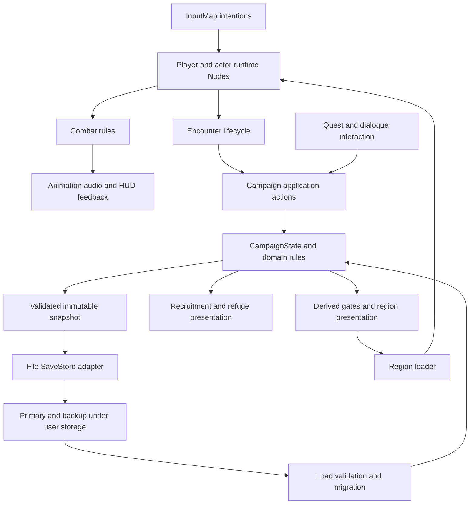

# Game architecture

## Shape and dependency direction

One local Godot executable; one modular game repository. No backend or account is required. Godot owns scene lifecycle, input, rendering, physics, navigation, animation and audio. Apply clean layering to decisions and durable state rather than wrapping the engine.

Presentation/UI and runtime Nodes → application orchestration → domain rules and state. Infrastructure implements persistence and asset loading at explicit seams. Domain rule objects may use basic Godot value types and RefCounted but do not query SceneTree, disk, input, Nodes or autoloads.

Prefer deep modules with a small interface. State the interface's preconditions, failure modes, ownership, timing and results. Add an adapter seam when real variation exists, such as in-memory and file saves. Do not mirror the folder tree with pass-through classes.

## Module ownership

| Module | Owns | External interface |
|---|---|---|
| Player | locomotion, input intentions, action state, camera rig | receive validated damage, expose actor identity/position, emit interaction intention |
| Combat | damage rules, teams, attack instances, guard and invulnerability | resolve DamageRequest → DamageResult |
| Encounters | enemy AI, boss phase, reset and encounter lifecycle | start/reset encounter, report defeat once |
| Campaign | durable world facts, rewards, gate conditions, chapters | apply semantic action → updated state + effects |
| Quests/Dialogue | definitions, conditional choices, quest evaluation | available choices, execute choice via Campaign |
| Allies | recruitment interpretation, active follower, orders/navigation | recruit/activate/order with eligibility result |
| Inventory | owned items, equipment, upgrade rules, shards | equip/upgrade/grant via validated commands |
| World | region loading, spawn points, gates, checkpoints | transition request, bind saved region state |
| Persistence | schema validation, migration, durable files, recovery | save snapshot/load result through one seam |
| UI/Audio | presentation of state and feedback | consume focused signals, submit intentions |

Campaign owns persistent facts. Scenes reflect these facts and cannot maintain competing permanent booleans. A Gate derives access from Campaign; it is not a separate source of truth. Definition catalogs are authored read-only Resources; runtime models are unique instances.

## Composition root and autoloads

Keep the initial autoload to GameRoot only. It composes CampaignSession, SaveStore, RegionLoader and AudioDirector. Settings may be a second autoload only when justified. Do not create a globally accessible manager for each subsystem. Inject dependencies through explicit setup before activation; ensure nodes cannot process while unconfigured.

Scene shape:

```
GameRoot
  ScreenLayer (menu/loading/pause)
  SessionRoot
    RegionHost (one active region)
    ActorsRoot (player + at most one companion)
    UILayer (HUD/dialogue/journal)
    AudioRoot
```

Player scene: CharacterBody3D root; CollisionShape3D; VisualRoot with replaceable mesh/AnimationTree; CameraPivot/SpringArm3D/Camera3D; runtime action controller; health/stamina model binding; hit/hurt areas; interaction query. Split scripts by coherent responsibility instead of a 2,000-line Player.gd. Never use animation to move the physics capsule independently.

Region scene: RegionController; authored geometry; static collision; NavigationRegion3D; named SpawnPoints; checkpoints; gates; encounter instances; NPC spawn descriptors; ambience; persistent props. Give authored persistent objects stable IDs independent of node paths and instance IDs.

Enemy scene: CharacterBody3D, visual rig, NavigationAgent3D, hurtbox, attack emitter, action state and perception. Reuse health/damage mechanisms through composition. Bosses extend encounter behavior through authored patterns rather than copying the whole enemy script.

## Planned folder tree (create lazily)

```
project.godot
ENGINE_VERSION.txt
AGENTS.md
CONTEXT.md
docs/ (this pack, ADRs, STATUS.md, testing evidence)
game/
  bootstrap/ (game_root.tscn, game_root.gd)
  core/ (IDs, result types only when shared)
  combat/{domain,runtime}/
  campaign/{domain,application}/
  inventory/{domain,application}/
  quests/{domain,application,runtime}/
  allies/{domain,runtime}/
  actors/{player,enemies,bosses}/
  world/{runtime,regions,refuge}/
  persistence/{domain,infrastructure}/
  ui/{menus,hud,dialogue,journal,settings}/
  audio/
content/{items,attacks,enemies,bosses,quests,dialogue,regions}/
assets/{models,animations,materials,textures,audio,fonts,icons}/
tests/{rules,integration,smoke,fixtures}/
tools/ (validation and packaging scripts)
```

The tree is guidance, not permission to create dozens of empty folders or stub files. Actual paths are recorded as implemented. Prefer snake_case.gd/.tscn/.tres filenames, PascalCase class_name, snake_case functions and stable lowercase dotted IDs. Do not collide with Godot built-in names or expose duplicate global class names.

## Signal and event ownership

Local signals handle transient UI/combat feedback. Semantic campaign actions handle persistent mutations. Subscribe/unsubscribe with lifecycle ownership, check instance validity after awaits, cancel timers on exit. No arbitrary subscriber is allowed to award XP or open gates independently. State is committed before presentation notifications.

Example: boss HP reaches zero → encounter stops outgoing damage → one validated defeat command → Campaign applies reward/fact exactly once → SaveStore writes snapshot → scene displays seal interaction → breaking the seal applies next atomic mutation → gate derives unlocked state. Save failures require visible recovery, not a false 'saved' message.


## Architecture diagram



The diagram describes responsibility flow, not a universal global message bus. Combat frames do not synchronously serialize to disk. GameRoot wires the concrete modules together.
